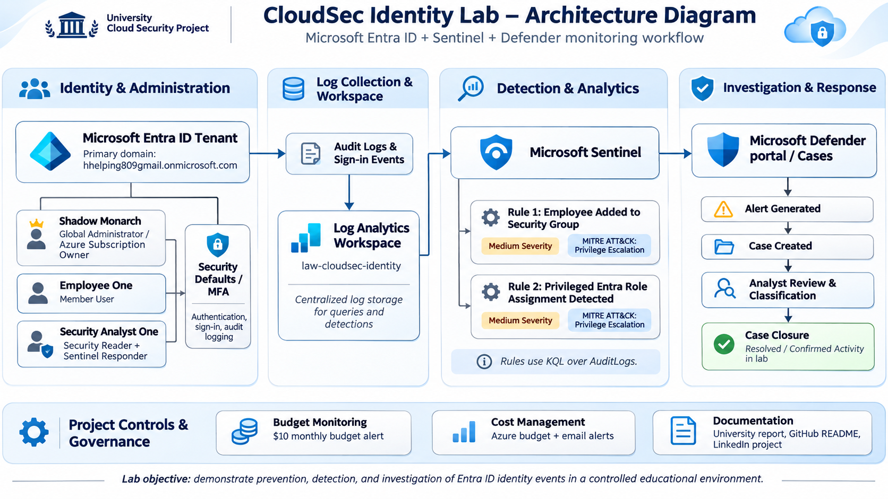

# CloudSec Identity Lab  
## Microsoft Entra ID + Microsoft Sentinel Identity Detection & Response Project

## Overview

This project demonstrates the design and implementation of a small enterprise-style cloud identity security lab using **Microsoft Entra ID, Azure Log Analytics, Microsoft Sentinel, and Microsoft Defender**.

The objective was to build an environment that demonstrates both **preventive identity security controls** and **SOC-style detection and response**.

The lab covers:

- User and group administration
- Role-Based Access Control (RBAC)
- Least privilege
- Multi-Factor Authentication
- Microsoft Entra ID audit logging
- Centralized log collection
- KQL-based threat detection
- Microsoft Sentinel analytics rules
- Alert and incident generation
- SOC investigation and classification
- Cost monitoring and Azure governance

---

# Architecture

The lab follows this detection pipeline:

**Microsoft Entra ID → Audit Logs → Log Analytics Workspace → Microsoft Sentinel → KQL Analytics Rules → Microsoft Defender Alerts/Cases → SOC Investigation**

### Architecture Diagram
<p align="center">
  
</p>

The environment contains three primary identities:

| Identity | Purpose | Permissions |
|---|---|---|
| Shadow Monarch | Lab administrator | Global Administrator / Azure Subscription Owner |
| Employee One | Standard employee/test user | Member |
| Security Analyst One | SOC analyst | Entra Security Reader + Microsoft Sentinel Responder |

This separation allowed the lab to demonstrate **least privilege** and the difference between **Microsoft Entra roles** and **Azure RBAC roles**.

---

# Technologies Used

- Microsoft Azure
- Microsoft Entra ID
- Microsoft Sentinel
- Microsoft Defender
- Azure Log Analytics
- Kusto Query Language (KQL)
- Entra AuditLogs
- Azure RBAC
- Microsoft Authenticator / MFA
- Azure Cost Management

---

# Phase 1 – Identity Environment Setup

The first phase focused on creating an enterprise-style identity environment.

### Users Created

- `Employee One`
- `Security Analyst One`
- Administrative lab account

Employee One represented a normal organizational user.

Security Analyst One represented a SOC analyst who needed security visibility without full administrative privileges.

### Security Groups

Security groups were created to simulate departmental and security access structures.

Examples included:

- `SG-Sales-Users`
- `SG-Security-Analysts`
- `SG-Test-Audit`

Employee One was added to the Sales group, while Security Analyst One was added to the Security Analysts group.

> **Screenshot:** Entra ID users and groups.

---

# Phase 2 – Least Privilege and RBAC

A core objective of the project was to prevent the security analyst account from receiving unnecessary administrative access.

Security Analyst One received two separate permissions.

### Microsoft Entra Role

**Security Reader**

This provides read-only access to security-related information within Microsoft Entra ID.

### Azure RBAC Role

**Microsoft Sentinel Responder**

This role allows the analyst to investigate and respond to Sentinel incidents without giving full control of Azure resources.

This demonstrates an important cloud-security concept:

> Microsoft Entra directory roles and Azure RBAC roles are separate permission systems.

The analyst therefore received only the permissions required for SOC operations.

> **Screenshot:** Security Reader assignment.

> **Screenshot:** Microsoft Sentinel Responder role assignment.

---

# Phase 3 – Multi-Factor Authentication

MFA was configured for the Security Analyst account using Microsoft Authenticator.

The objective was to strengthen authentication security while demonstrating identity protection controls.

Authentication activity was also visible within Microsoft Entra audit logs.

> **Screenshot:** MFA registration or authentication method configuration.

---

# Phase 4 – Log Analytics and Microsoft Sentinel

A Log Analytics workspace was created:

`law-cloudsec-identity`

Microsoft Sentinel was enabled on this workspace.

Microsoft Entra ID audit logs were connected to Sentinel so identity administration activity could be centrally queried and monitored.

The following log source was successfully ingested:

`AuditLogs`

A basic validation query confirmed that Entra administrative activity was reaching Sentinel:

```kusto
AuditLogs
| order by TimeGenerated desc
```

> **Screenshot:** AuditLogs returning Entra events.

---

# Phase 5 – KQL Investigation

KQL was used to investigate identity activity and extract useful SOC fields.

Important operators used during the project included:

- `where`
- `has`
- `tostring()`
- `extend`
- `project`
- `order by`

The project also demonstrated why `has` can be preferable to broad substring matching such as `contains` when searching tokenized strings.

---

# Detection Scenario 1 – Security Group Membership Change

## Objective

Detect when Employee One is added to a security group.

A controlled test event was generated by adding Employee One to:

`SG-Test-Audit`

The event appeared in Entra AuditLogs as:

`Add member to group`

### Initial Query

```kusto
AuditLogs
| where OperationName has "member"
| where tostring(TargetResources) has "employee1"
| order by TimeGenerated desc
```

During investigation, this query was found to be too broad because it matched both:

- `Add member to group`
- `Remove member from group`

This created a useful detection-engineering lesson: a technically valid query can still create misleading alerts if filtering is too broad.

### Tuned Detection Query

```kusto
AuditLogs
| where OperationName == "Add member to group"
| where tostring(TargetResources) has "employee1"
| extend TargetUser = tostring(TargetResources[0].userPrincipalName)
| extend InitiatedByUser = tostring(InitiatedBy.user.userPrincipalName)
| extend InitiatedByIP = tostring(InitiatedBy.user.ipAddress)
| project TimeGenerated,
          OperationName,
          TargetUser,
          InitiatedByUser,
          InitiatedByIP,
          Result
```

The improved query extracted the most useful investigation fields:

- Target user
- Initiating identity
- Source IP
- Operation name
- Result
- Timestamp

> **Screenshot:** Tuned KQL query results.

---

# Analytics Rule 1 – Employee Added to Security Group

A scheduled Microsoft Sentinel analytics rule was created from the tuned KQL query.

### Configuration

**Rule Name:**  
`Employee Added to Security Group`

**Severity:**  
Medium

**MITRE ATT&CK Tactic:**  
Privilege Escalation

**Schedule:**  
Every 5 minutes

**Lookback:**  
10 minutes

**Alert Threshold:**  
Greater than 0 results

**Incident Creation:**  
Enabled

The 10-minute lookback was selected after observing several minutes of ingestion delay between the original Entra event and its arrival in Log Analytics.

> **Screenshot:** Analytics rule configuration.

---

# Incident Investigation 1

The analytics rule successfully generated a Microsoft Defender case.

The alert investigation showed:

- Target: Employee One
- Operation: Add member to group
- Result: Success
- Initiating administrator
- Source IP
- Event timestamp

The incident was assigned to the Security Analyst account and investigated as a SOC analyst.

Because the activity was intentionally generated during the lab, it was classified as:

**Informational / Expected Activity / Confirmed Activity**

The incident was then resolved.

### Investigation Workflow

**Detection → Alert → Incident → Analyst Review → Classification → Resolution**

> **Screenshot:** Group membership alert.

> **Screenshot:** Incident investigation details.

> **Screenshot:** Closed/resolved case.

---

# Detection Scenario 2 – Privileged Entra Role Assignment

## Objective

Detect when a user is assigned an Entra ID administrative/security role.

Employee One was temporarily assigned the:

`Security Reader`

role.

The resulting Entra audit event appeared as:

`Add member to role`

with the category:

`RoleManagement`

### Discovery Query

```kusto
AuditLogs
| where TimeGenerated > ago(2h)
| where tostring(TargetResources) has "employee1"
| project TimeGenerated,
          OperationName,
          Category,
          LoggedByService,
          TargetResources,
          InitiatedBy,
          Result
| order by TimeGenerated desc
```

This confirmed the exact event generated by Entra.

### Final Detection Query

```kusto
AuditLogs
| where OperationName == "Add member to role"
| where Category == "RoleManagement"
| where tostring(TargetResources) has "employee1"
| extend TargetUser = tostring(TargetResources[0].userPrincipalName)
| extend InitiatedByUser = tostring(InitiatedBy.user.userPrincipalName)
| extend InitiatedByIP = tostring(InitiatedBy.user.ipAddress)
| project TimeGenerated,
          OperationName,
          Category,
          TargetUser,
          InitiatedByUser,
          InitiatedByIP,
          Result
```

> **Screenshot:** RoleManagement KQL result.

---

# Analytics Rule 2 – Privileged Entra Role Assignment

A second scheduled analytics rule was created.

### Configuration

**Rule Name:**  
`Privileged Entra Role Assignment Detected`

**Description:**  
Detects when Employee One is assigned an Entra ID role.

**Severity:**  
Medium

**MITRE ATT&CK Tactic:**  
Privilege Escalation

**Schedule:**  
Every 5 minutes

**Lookback:**  
10 minutes

**Threshold:**  
More than 0 results

**Incident Creation:**  
Enabled

> **Screenshot:** Second analytics rule enabled in Sentinel.

---

# Incident Investigation 2

The privileged-role assignment rule successfully generated:

`Privileged Entra Role Assignment Detected`

The incident contained:

- Category: `RoleManagement`
- Operation: `Add member to role`
- Target: Employee One
- Initiating administrator
- Source IP
- Result: `success`

The incident was investigated and classified as expected activity because the role assignment was intentionally performed as part of the lab.

The case was then closed.

> **Screenshot:** Privileged role assignment alert.

> **Screenshot:** Investigation fields.

> **Screenshot:** Closed Case ID 6.

---

# Detection Tuning and Troubleshooting

This project included several troubleshooting scenarios that improved the quality of the final detections.

## Broad Query Matching

The original group-membership query used:

```kusto
OperationName has "member"
```

This matched both additions and removals.

The detection was tuned to:

```kusto
OperationName == "Add member to group"
```

This reduced false or misleading matches.

## Log Ingestion Delay

The following query was used to compare event generation time with Log Analytics ingestion time:

```kusto
AuditLogs
| where OperationName has "member"
| where tostring(TargetResources) has "employee1"
| extend IngestedAt = ingestion_time()
| extend DelayMinutes = datetime_diff("minute", IngestedAt, TimeGenerated)
| project TimeGenerated,
          IngestedAt,
          DelayMinutes,
          OperationName,
          TargetResources,
          Result
```

Observed ingestion delay was approximately several minutes.

This resulted in changing analytics-rule lookback periods from 5 minutes to 10 minutes.

## Sentinel Backend Error

During creation of the second analytics rule, Microsoft Defender temporarily returned:

`InternalServerError`

The KQL was independently validated in Sentinel Logs, and a minimal analytics-rule configuration produced the same error.

The issue was later resolved without changing the detection logic, confirming that it was a transient platform-side issue.

This demonstrated the importance of separating:

- Query problems
- Configuration problems
- Ingestion problems
- Platform/service problems

---

# Cost Management and Governance

After the Azure free-trial period ended, the subscription was upgraded to Pay-As-You-Go.

To reduce financial risk, Azure Cost Management was configured.

### Budget Configuration

**Monthly Budget:**  
CA$10

Budget alerts were configured to warn when spending approached configured thresholds.

This added an additional cloud-governance layer to the project and demonstrated awareness of operational cost management.

> **Screenshot:** Azure budget configuration.

---

# Security Concepts Demonstrated

This project demonstrates practical understanding of:

- Identity and Access Management
- Least Privilege
- Role-Based Access Control
- Microsoft Entra ID
- Azure RBAC
- MFA
- Centralized Logging
- SIEM
- KQL
- Detection Engineering
- Alert Triage
- Incident Investigation
- MITRE ATT&CK Mapping
- Privilege Escalation Monitoring
- False Positive / Expected Activity Validation
- Cloud Cost Governance
- SOC Documentation

---

# SOC Investigation Methodology

The alerts were investigated using a simple **5W/1H** methodology.

### Who?

Target user and initiating administrator.

### What?

Identity or privilege change performed.

### When?

Timestamp from Entra AuditLogs.

### Where?

Source IP recorded in the audit event.

### Why?

Validated against authorized lab activity.

### How?

Microsoft Entra administrative operation captured through AuditLogs and detected through Microsoft Sentinel analytics rules.

---

# Key Findings

The project demonstrated that seemingly simple identity operations can provide valuable detection opportunities.

Two important identity events were successfully monitored:

1. Security group membership changes
2. Entra role assignments

Both scenarios were successfully transformed from raw audit events into:

**Logs → KQL detections → Sentinel analytics rules → Defender incidents → SOC investigations**

The project also showed that detection engineering requires continuous tuning. Broad matching, ingestion latency, and platform behavior can all affect alert reliability.

---

# Lessons Learned

- Cloud identity logs contain highly valuable security telemetry.
- Least privilege should apply to analysts as well as normal users.
- KQL queries should be validated against real log structures instead of assumed event names.
- Detection queries should be as specific as necessary to reduce noise.
- Log ingestion latency must be considered when designing scheduled analytics rules.
- Alerts are only useful when analysts can extract meaningful investigation context.
- Detection engineering includes troubleshooting and tuning, not only writing queries.
- Cost governance should be considered when operating cloud security labs.

---

# Project Outcome

The lab successfully demonstrated an end-to-end identity detection and response workflow using Microsoft cloud-security technologies.

The completed environment includes:

- Enterprise-style Entra ID users and groups
- Least-privilege security analyst account
- MFA
- Role separation
- Centralized AuditLogs
- Log Analytics
- Microsoft Sentinel
- Custom KQL detections
- Two scheduled analytics rules
- MITRE ATT&CK mapping
- Defender alert and case generation
- Incident investigation and classification
- Detection tuning
- Cost management controls

---

# Future Improvements

Future versions of the lab could include:

- Failed-login / password-spray detection
- Successful login after repeated failures
- Authentication-method modification detection
- User account disable/delete detection
- Conditional Access policies
- Entra ID Protection
- Automated Sentinel playbooks
- Logic Apps-based response automation
- Threat intelligence enrichment
- Additional MITRE ATT&CK mappings
- Sentinel dashboards/workbooks

---

# Repository Structure

```text
CloudSec-Identity-Lab/
│
├── README.md
│
├── architecture/
│   └── cloudsec-identity-lab-architecture.png
│
├── queries/
│   ├── group-membership-detection.kql
│   └── privileged-role-assignment.kql
│
├── screenshots/
│   ├── entra-users.png
│   ├── security-groups.png
│   ├── sentinel-auditlogs.png
│   ├── group-detection-query.png
│   ├── analytics-rule-1.png
│   ├── incident-1.png
│   ├── privileged-role-query.png
│   ├── analytics-rule-2.png
│   ├── incident-2.png
│   └── azure-budget.png
│
└── docs/
    └── project-notes.md
```

---

# Disclaimer

This project was created in a controlled educational lab environment.

All users, role assignments, group changes, alerts, and incidents shown in this repository were intentionally generated for learning, testing, and demonstration purposes.

Sensitive information such as credentials, authentication secrets, subscription identifiers, tenant identifiers, and unnecessary personal information should be removed or redacted from screenshots before publication.

---

## Author

**Manav**

Cybersecurity | SOC Analysis | Detection Engineering | Cloud Security

GitHub: `github.com/mnv1851`
